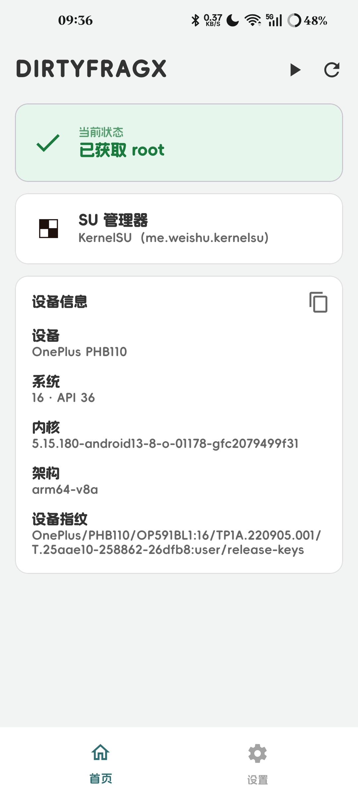

# DirtyFragX (CVE-2026-43284)

[English](README.md) · **简体中文**

> fork 自 [mitschud/DirtyFrag](https://github.com/mitschud/DirtyFrag)

## 改动

- 修复原项目的逻辑问题导致的一系列常见问题
- 界面重构
- 提供简体中文界面

> 本分支的后续维护由本人负责。

## 安装

1. 从 [Releases](https://github.com/mitschud/DirtyFrag/releases/latest) 安装 DirtyFragX APK。

2. 安装一个**自带 `libksud.so`** 的 SU 管理器：

    - 三星——**必须**：

        - [diabl0w 的 KernelSU](https://github.com/diabl0w/KernelSU/releases)

    - 其他：

        - [KernelSU](https://github.com/tiann/KernelSU/releases/latest)

        - [KernelSU-Next](https://github.com/KernelSU-Next/KernelSU-Next/releases/latest)

        - [KowSU](https://github.com/KOWX712/KernelSU/releases/latest)

        - [BakaSU](https://github.com/Baka-SU/BakaSU/releases/latest)（原 ReSukiSU）



## 构建

```sh
JAVA_HOME="<Android Studio jbr>" ./gradlew assembleRelease
```

APK 输出到 `app/build/outputs/apk/release/dirtyfrag.apk`。

Release 构建使用 `app/keystore.jks` 签名，该文件已被 gitignore（签名配置要求别名为 `dirtyfrag`，两个密码也都是 `dirtyfrag`）。构建前请自行生成：

```sh
keytool -genkeypair -v -keystore app/keystore.jks -alias dirtyfrag -keyalg RSA -keysize 2048 -validity 10000 -storepass dirtyfrag -keypass dirtyfrag
```

八个预编译内核模块已提交在 `app/src/main/jni/ko/` 下。上游会 gitignore 它们并在 CI 中按 KMI 构建；本分支直接提交，因此普通 clone 无需 DDK 工具链即可构建。它们由本仓库的 `Build` 工作流（`LKMs / <kmi>` 任务）基于当前的 `lkm/dfroot.c` 构建，所以该文件一旦修改就必须重新构建：运行工作流，下载 `df-lkm-<kmi>` 产物并放入该目录。若想自行构建，请改用上游的 `make` / podman DDK 流程。

## 常见问题

**Q：日志显示 patching failed，并说我的设备不受影响**

A：抱歉，没有修复方法。可能是：

- 你的设备内核太新
- 你的设备厂商回移了官方缓解补丁
- [accidental mitigation](https://github.com/V4bel/dirtyfrag/issues/23#issuecomment-4405314290)（常见于内核 6.1）

**Q：我装了模块，现在一启动 root 就崩溃**

A：把 **KernelSU Modules** 卡片设为 Disabled 后重新 root。该开关无需 root 即可生效，这正是它的意义——当模块就是导致运行崩溃的原因时，它是逃生通道。

**Q：模块 + Autorun，现在开机循环了**

A：Android 通常能检测到开机循环并提供安全模式；否则在启动时按住**音量下键**。进入安全模式后关闭 Autorun、把 KernelSU Modules 设为 Disabled，或者在稳定之前直接卸载 DirtyFrag。如果连系统都进不去，在任意 PC 上执行 `adb uninstall df.root` 即可（用户版本无需 root）。

**Q：如何干净地移除 root？**

A：取消 root 之前，用支持 root 的文件管理器删除 `/data/adb/KernelSU`、KSUD 残留（不要删除 ADB 文件夹本身）。

## 工作原理

Android 内核会把 AES-CBC ESP 数据包直接解密到以 `splice()` 打开的文件的页缓存中。通过构造 `IV = AES_ECB_DEC(key, current_content) XOR desired_content`，可以覆盖映射的共享库中任意 16 字节对齐的块，无需写权限，也不会触发写时复制。

该利用链用这一原语把 shellcode 补丁进内核页缓存中的 `libc++.so`。下一次对被挂钩函数的特权调用会执行 shellcode，后者通过 `insmod` 加载内核模块。

### 利用链

1. **IpSec transform**——应用分配一个 `UdpEncapsulationSocket` 和一个 SPI，并通过 `IpSecManager` 构建 AES-CBC/HMAC-SHA256 ESP 转换。
2. **splicehelper -> crash_dump64**——利用 CBC 原语把 splicehelper 拼接进 `crash_dump64`。`crash_dump64` 运行在 `crash_dump` SELinux 域中，可以打开标记为 `vendor_file`、而 `untrusted_app` 无法读取的文件——这正是我们需要的桥梁。
3. **dfroot.ko -> vendor_file**——内核模块通过该桥梁写入一个标记为 `vendor_file` 的文件。
4. **libc++ hook**（在 init 中触发，uid=0，tid=1）——shellcode 被补丁到 `std::ostream::sentry::sentry()`。它检查 uid 与 tid，创建 `/dev/df` 作为一次性互斥，防止重入，然后在 `vendor_modprobe` 域中执行 `insmod`。
5. **dfroot.ko init**——将 SELinux 设为 permissive，在存在 DEFEX 的地方通过 kprobe 绕过，然后使用 `call_usermodehelper` 运行 bootstrap。
6. **bootstrap**——读取应用的设备保护存储设置，继承 zygote 环境，将分区设为只读，可选地禁用所有模块，最后从你安装的 SU 管理器启动 SU 守护进程。

## 致谢

- 本分支基于：https://github.com/mitschud/DirtyFrag
- 原始项目与利用链：https://github.com/diabl0w/DFRoot
- 原始 PoC 及部分代码：https://github.com/lsposed/lspromise
- SELinux permissive 内核模块及部分代码：https://github.com/polygraphene/DFReroot
- 非特权 XFRM socket 方法：https://github.com/combeng6th/DirtyInit
